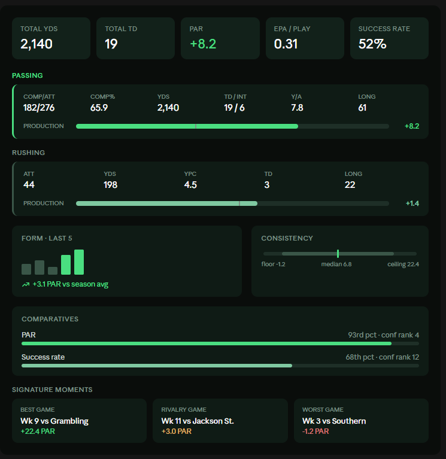

Nice system you've already got going — that comparatives/gauge/timeline language is strong, so the Overview tab should extend it rather than introduce a new visual grammar. Here's how I'd break down that field list:

**1. Headline strip** — 4-5 metric cards up top (Total Yds, Total TD, PAR, EPA/play, Success Rate). Same visual weight as the Glory Rating gauge — first thing the eye hits.

**2. Production blocks** — this is the core of the tab. Each block (Passing/Rushing/Receiving) is a card that only renders if the player has volume in it (a backup RB doesn't get a receiving card). Inside each: a compact stat grid for the counting stats, plus a small horizontal bar showing `{block}_production` vs `{block}_replacement_baseline` with the delta as the PAR badge — this turns three abstract numbers into one instantly-readable "how much better than replacement" bar.

**3. Form** — a sparkline of `rolling3_par_series` with the trend arrow, sitting next to last-3/last-5 averages. Reuses the same bar-chart language as your "PAR by game" module on the Bio tab.

**4. Consistency & floor** — this is a great fit for a range/floor-ceiling bar: floor — median — ceiling as a horizontal track, with boom/bust game counts as small badges. Tells a story ("high ceiling, low floor") in one glance.

**5. Comparatives** — you already solved this with the Height/Weight percentile bars. Reuse that exact component per stat, just make it scrollable/filterable since there are a lot of candidate stats.

**6. Signature moments** — small horizontal card row (best game, worst game, standout play), same shape as "Game Spotlight."

Here's a mockup of how that stacks together:A few notes on why it's laid out this way:

- **Production blocks get a border-left accent that fades by relevance** — passing is the bright green (it's his primary block), rushing is muted. That visually communicates "role" without a label.
- **The replacement-baseline tick mark inside each production bar** is doing a lot of work — one glance tells you not just "how much production" but "how much above expectation," which is really the whole point of PAR as a stat.
- **Consistency uses a floor-to-ceiling track with a median tick**, not a boxplot — boxplots read as clinical/statistical, and your site's voice is more "broadcast graphics package."
- Game log and trend tabs are natural extensions of the sparkline and per-game series data — I'd keep those as full-width charts rather than cards once you get to that tab.

Want me to mock up the game log or trend tab next, or refine spacing/colors on this one first?

